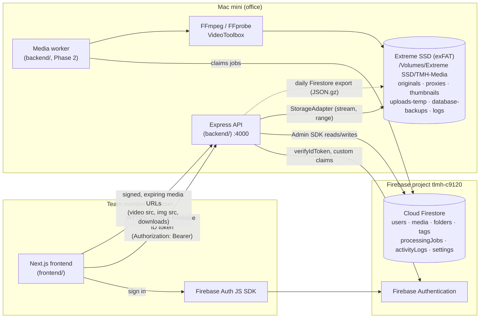

# Terence Media Hub — Architecture

Status: **Phase 1 (restructuring and architecture) complete. Phase 2 (Firebase backend) not started.**
Last updated: 19 November 2026.

TMH is an internal media asset management platform for a creative studio: raw footage, audio, images, proxies,
thumbnails, folders, tags and searchable metadata. It runs on an office **Mac mini** with an external
**SanDisk Extreme SSD** as primary media storage, and uses **Firebase** (Authentication + Cloud Firestore) for
identity and metadata.

## 1. System overview



Key rules:

- **Media bytes never go to Firebase.** Originals, proxies and thumbnails live only on the SSD. Firestore holds
  metadata and *storage keys* (relative logical paths), never absolute paths.
- **The browser never touches the filesystem or Firebase Admin credentials.** All file access goes through the backend.
- **The backend is the only writer to Firestore.** Security rules deny all client writes (see [FIREBASE.md](FIREBASE.md)).
- **No silent fallback.** If the SSD is unplugged, uploads/downloads fail with a clear error; nothing is ever
  written to the Mac's internal disk instead.
- **Originals are never re-encoded, overwritten or deleted by processing.**

## 2. Repository structure (after Phase 1)

```
terence-media-hub/
├── package.json            npm workspaces root: shared, frontend, backend; root scripts
├── .env.example            every setting, placeholders only (real .env is git-ignored)
├── firebase.json           Firebase CLI config (rules + indexes; not deployed yet)
├── firebase/
│   ├── firestore.rules     security rules: clients read-only, backend writes
│   └── firestore.indexes.json
├── shared/                 @tmh/shared — pure TypeScript used by both sides
│   └── src/
│       ├── api-types.ts    target API contract (DTOs, envelope, query types)
│       ├── media-types.ts  content-based file type detection, accepted extensions
│       └── http-range.ts   HTTP Range parsing, Content-Disposition
├── frontend/               @tmh/frontend — the existing Next.js 15 app (moved, not rewritten)
│   ├── src/app/            pages: / (dashboard), /library, /uploads, /folders, /storage, /login
│   │   └── api/            LEGACY MySQL API routes (replaced by backend/ in Phase 2)
│   ├── src/components/     app shell, media card/detail, library browser, storage panel
│   ├── src/lib/client.ts   API client (api(), apiUrl(), NEXT_PUBLIC_API_BASE_URL) + formatters
│   ├── src/server/         LEGACY server code (Prisma/MySQL, FFmpeg, jobs, backups)
│   ├── prisma/, scripts/, deploy/   LEGACY MySQL schema, worker, launchd files
│   └── tests/unit/         frontend + legacy unit tests
├── backend/                @tmh/backend — Express + TypeScript API (foundation built in Phase 1)
│   ├── src/
│   │   ├── server.ts       entry point (listen, graceful shutdown)
│   │   ├── app.ts          Express app: CORS allow-list, security headers, JSON limits, routes, errors
│   │   ├── config/env.ts   validated configuration from the root .env
│   │   ├── storage/        StorageAdapter interface + LocalSsdStorageAdapter
│   │   ├── routes/         route table (Phase 1: /api/health)
│   │   ├── controllers/    request handlers
│   │   ├── middleware/     errors, 404 (Phase 2: auth, upload limits)
│   │   └── http/           JSON envelope helpers, HttpError
│   └── tests/              adapter + HTTP tests
├── scripts/
│   ├── dev.mjs             `npm run dev` → frontend + backend
│   ├── setup/init-storage.sh        creates the SSD folder layout + marker (never deletes)
│   └── diagnostics/check-environment.sh   read-only health check of the Mac mini
└── docs/                   this documentation (docs/archive = superseded Supabase-era docs)
```

### Planned backend layout (Phase 2)

Phase 2 adds these folders to `backend/src/`, keeping the layers separate:

| Folder | Responsibility | Talks to |
| --- | --- | --- |
| `routes/` | URL → controller mapping, per-route auth/role middleware | controllers |
| `controllers/` | Parse/validate the HTTP request, call a service, shape the response | validators, services |
| `validators/` | zod schemas for bodies and query strings | — |
| `services/` | Business rules (upload workflow, search, folder rules, permissions) | repositories, storage, media |
| `repositories/` | The only code that reads/writes Firestore (Admin SDK) | Firestore |
| `models/` | Firestore document shapes and converters (Timestamp ↔ ISO) | — |
| `storage/` | `StorageAdapter` implementations (local SSD now; S3/R2 later) | filesystem |
| `media/` | FFprobe/FFmpeg wrappers (ported from `frontend/src/server/ffmpeg.ts`) | ffmpeg binaries |
| `jobs/` | Job queue (Firestore-backed), worker loop, retries | repositories, media, storage |
| `middleware/` | `auth.ts` (verify ID token, load role), `require-role.ts`, rate limits | Firebase Auth |
| `utils/`, `types/` | Small helpers and backend-only types | — |

## 3. Current state of features

| Feature | Where it works today | Phase 2 target |
| --- | --- | --- |
| Dashboard, library grid, filters, detail modal, upload UI, folders UI, storage page | `frontend/` (UI complete) | Same UI, pointed at the Express API |
| Sign-in | Legacy username/password against MySQL (not yet usable: MySQL password not configured) | Firebase Authentication |
| Metadata database | Legacy Prisma/MySQL schema (no tables created) | Cloud Firestore |
| SSD storage | Legacy `frontend/src/server/storage.ts` **and** new `backend/src/storage/` (tested) | Backend adapter only |
| FFmpeg probe / thumbnail / 720p proxy | Legacy worker (tested on synthetic clips) | Backend worker |
| Health check | Backend `/api/health` (tested) | + Firestore ping |

See [ROADMAP.md](ROADMAP.md) for the precise Phase 2 plan and [API.md](API.md) for the contract.

## 4. Key design decisions

1. **Keep the existing Next.js frontend; add a separate Express backend.** The frontend stays a UI. Large uploads,
   streaming, FFmpeg and the job worker run in a long-lived Node process that is independent of the frontend framework.
2. **npm workspaces** link `shared/`, `frontend/` and `backend/` with one `node_modules` and one lockfile at the root.
   `@tmh/shared` is TypeScript source, compiled by Next (`transpilePackages`) and run by `tsx` in the backend.
3. **Firestore is the only metadata database** (decision of 19 Nov 2026). The legacy MySQL code remains only until
   Phase 2 replaces each screen's data source; its removal needs explicit approval.
4. **Media URLs are signed.** `<video>`, `` and download links cannot send `Authorization` headers, so the
   backend issues short-lived HMAC-signed URLs (for example 15 minutes) bound to media ID, variant and user.
5. **Search with Firestore** uses normalised keyword tokens stored on each media document (`searchTokens`)
   because Firestore has no substring/full-text search. See [FIREBASE.md §4](FIREBASE.md#4-search-design).
6. **Processing is sequential** (one FFmpeg job at a time) so a Mac mini stays responsive; VideoToolbox hardware
   encoding with a libx264 fallback.

## 5. Risks and known constraints

| Risk | Impact | Mitigation |
| --- | --- | --- |
| Office internet outage | Firebase sign-in and metadata unavailable, even though files are local | Documented; ID tokens stay valid ~1 h; consider Firestore offline cache for reads later |
| Firestore free (Spark) quota: 50k reads / 20k writes per day | Library polling or bulk imports could exceed it | Cursor pagination, onSnapshot listeners instead of polling, aggregate counts; monitor usage; Blaze plan if needed |
| Firestore substring search impossible | "contains" search on filenames not supported | Token + prefix search now; optional Typesense (self-hosted) later |
| SSD is exFAT (no journal) | Power loss or unplugging mid-write can corrupt the volume | Eject before unplugging; UPS recommended; second backup drive required |
| SSD is a single copy | Drive failure loses originals | A second physical backup drive is required (not yet purchased) |
| Mac internal disk 92% full | macOS and app stability | Keep media off the internal disk (already enforced) |
