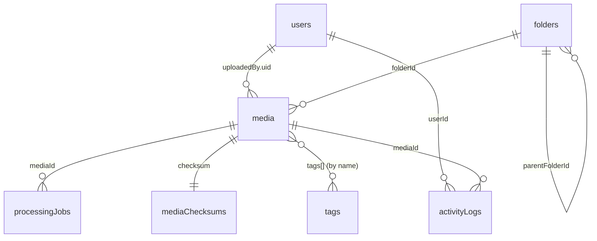

# Firebase design

Firebase project: **`tlmh-c9120`**. Firebase Authentication identifies users; **Cloud Firestore is the only
metadata database**. Media files are never stored in Firestore or Firebase Storage.

Files: [`firebase/firestore.rules`](../firebase/firestore.rules), [`firebase/firestore.indexes.json`](../firebase/firestore.indexes.json), [`firebase.json`](../firebase.json).
Nothing has been deployed yet (Phase 2).

## 1. Authentication

- Sign-in method: **Email/Password** (Google sign-in can be enabled later without code changes to the backend).
- Public sign-up is **disabled**: admins create accounts through the backend (`POST /api/users`, Admin SDK).
- The frontend signs in with the Firebase JS SDK and sends the **ID token** as `Authorization: Bearer <token>`.
- The backend verifies every token with `admin.auth().verifyIdToken(token, true)` (also checks revocation) and
  reads the role from **custom claims** (`role`, `active`) that only the backend sets. Role information sent by the
  browser is never trusted.
- Disabling a user: set `active: false` (claims + `users` doc) and revoke refresh tokens, so access ends within minutes.

### Roles

| Capability | viewer | editor | admin |
| --- | :-: | :-: | :-: |
| Browse, search, preview, view metadata | ✔ | ✔ | ✔ |
| Download original / proxy | ✔ | ✔ | ✔ |
| Upload; edit title, tags, description, category; move media | | ✔ | ✔ |
| Create / rename / move / delete empty folders | | ✔ | ✔ |
| Retry failed processing jobs | | ✔ | ✔ |
| Remove media from the library (soft delete; original kept) | | | ✔ |
| Manage users and roles, settings, run backups, view activity log | | | ✔ |

## 2. Collections

Timestamps are Firestore `Timestamp`s (sent to the browser as ISO strings). IDs are Firestore auto-IDs unless noted.

### `users/{uid}` (document ID = Firebase Auth UID)
| Field | Type | Notes |
| --- | --- | --- |
| uid | string | same as document ID |
| displayName | string | |
| email | string | lower-case |
| role | `"admin" \| "editor" \| "viewer"` | mirror of the custom claim (claim is authoritative) |
| active | boolean | |
| createdAt, lastLoginAt | Timestamp | lastLoginAt updated by the backend on first request of a session |

### `media/{mediaId}`
| Field | Type | Notes |
| --- | --- | --- |
| mediaId | string | = document ID; also used for the stored filename |
| title | string | editable; defaults to the filename without extension |
| originalFileName | string | sanitised client filename, metadata only |
| storedFileName | string | `<mediaId>.<ext>`; never derived from user input |
| mediaType | `"video" \| "audio" \| "image"` | from file content, not the name |
| mimeType, fileExtension | string | from content detection |
| fileSize | number | bytes |
| duration | number \| null | seconds |
| width, height | number \| null | display orientation (rotation applied) |
| frameRate | number \| null | |
| codec, audioCodec | string \| null | |
| bitRate | number \| null | |
| category | string \| null | e.g. Dance, Fitness, Podcast |
| categoryLower | string \| null | for equality filters |
| description | string \| null | not indexed |
| folderId | string \| null | reference to `folders/{id}` (no arrays of media on folders) |
| tags | string[] | normalised lower-case, max 30 |
| searchTokens | string[] | see §4; max ~200 entries |
| storageKey | string | e.g. `originals/videos/2026/11/<mediaId>.mov` |
| proxyStorageKey | string \| null | e.g. `proxies/videos/2026/11/<mediaId>.mp4` |
| thumbnailStorageKey | string \| null | e.g. `thumbnails/2026/11/<mediaId>.jpg` |
| proxySize, thumbnailSize | number \| null | bytes, for storage totals |
| checksum | string | SHA-256 hex of the original |
| processingStatus | `"pending" \| "processing" \| "ready" \| "failed"` | |
| probeData | map | trimmed ffprobe summary, not indexed |
| uploadedBy | map `{ uid, displayName }` | denormalised for display |
| deletedAt | Timestamp \| null | soft delete; **all library queries filter `deletedAt == null`** |
| createdAt, updatedAt | Timestamp | |

### `mediaChecksums/{sha256}`
Duplicate detection. Created in the **same transaction** as the media document; if it already exists the upload is
a duplicate and the new file is discarded (never overwrites). Fields: `mediaId`, `createdAt`.

### `folders/{folderId}`
| Field | Type | Notes |
| --- | --- | --- |
| folderId | string | |
| name | string | display name only, never a filesystem path |
| nameLower | string | uniqueness among siblings, sorting |
| parentFolderId | string \| null | max depth 8, cycles rejected by the backend |
| description | string \| null | |
| createdBy | string | uid |
| createdAt, updatedAt | Timestamp | |

Folder contents are found by querying `media where folderId == X` (never stored as arrays). Counts use
`count()` aggregation queries.

### `tags/{tagId}` (document ID = normalised tag name)
`tagId`, `name`, `category` (optional grouping, e.g. "people", "event"), `usageCount` (maintained in transactions), `createdAt`.

### `processingJobs/{jobId}`
| Field | Type | Notes |
| --- | --- | --- |
| jobId | string | |
| mediaId | string | |
| jobType | `"probe" \| "thumbnail" \| "proxy"` | |
| status | `"queued" \| "running" \| "completed" \| "failed"` | |
| progress | number | 0–100 from FFmpeg `-progress` output (never simulated) |
| attempts | number | retry up to 2 for transient errors |
| error | string \| null | |
| workerId | string \| null | which worker claimed it |
| runAfter | Timestamp | retry back-off |
| createdAt, startedAt, completedAt | Timestamp \| null | |

The worker claims a job with a transaction (`status == "queued"` → `running`), so two workers can never run the same job.

### `activityLogs/{activityId}`
`activityId`, `userId`, `action` (`upload`, `download_original`, `download_proxy`, `update_metadata`, `move`,
`delete`, `folder_create`, `role_change`, `backup`, …), `mediaId` (nullable), `details` (small map), `timestamp`.
Write-once by the backend.

### `settings/{settingId}`
Application settings, e.g. `settings/app`: `maxUploadBytes`, `allowedExtensions`, `proxyPreset`. The SSD path stays
in `.env` on the Mac (never in Firestore).

### `backups/{backupId}`
`fileName`, `sizeBytes`, `status`, `trigger` (`daily` / `manual`), `error`, `createdAt`, `completedAt`.

## 3. Relationships

## 4. Search design

Firestore cannot search inside strings (no `LIKE '%term%'`) and allows only one `array-contains` per query. TMH therefore:

1. Builds `searchTokens` on every write of a media document, from title, original filename, category, tags and folder name:
   lower-cased, accents removed, split on non-alphanumerics (`Terence_Interview-Final.mov` → `terence`, `interview`, `final`),
   plus **prefixes** of each token from 3 characters (`ter`, `tere`, …) so typing part of a word works.
2. Queries the **most selective word** with `searchTokens array-contains <word>` plus equality filters
   (type, folder, status) and `orderBy createdAt desc`, using the composite indexes in `firestore.indexes.json`.
3. Applies remaining words and range filters (date, duration) in the backend on the fetched page.
4. Parses date phrases ("June 2026") into `createdAt` ranges.

Limits: no matching in the middle of a word (`view` will not find `interview`); folder renames require re-tokenising
that folder's media (done by a background job). If this proves insufficient, a self-hosted **Typesense** on the
Mac mini can be added later as a search index, with Firestore remaining the source of truth.

## 5. Security rules summary

- Default **deny everything**.
- Clients **never write** any collection; the backend uses the Admin SDK.
- Signed-in, active members (`role` claim) may **read** `media` (non-deleted), `folders`, `tags`, `processingJobs`,
  `settings`, enabling live progress updates with `onSnapshot` instead of polling.
- Users read their own `users` doc; admins read all users, `activityLogs`, `backups`.
- `mediaChecksums` is backend-only.
Rules must be tested with the Firebase Emulator before deployment (Phase 2).

## 6. Quotas (Spark free plan, check before launch)

50,000 document reads, 20,000 writes and 20,000 deletes per day; 1 GiB stored. Design choices that keep usage low:
cursor pagination (24 items per page), `count()`/`sum()` aggregation for dashboard numbers, `onSnapshot` on the visible
page only, progress written at most every 2 seconds per running job. If the team outgrows Spark, the Blaze plan is
pay-as-you-go and requires a billing account.

## 7. Backups

Managed Firestore export needs the Blaze plan and a Cloud Storage bucket. For the MVP, the backend writes a daily
**JSON export of all collections** (Admin SDK, paginated) to `TMH-Media/database-backups/firestore-YYYYMMDD-HHMMSS.json.gz`,
keeps the last 30, and records each run in `backups`. A restore script re-imports a chosen export (with confirmation).

## 8. Credentials

| Item | Secret? | Where |
| --- | --- | --- |
| Web config (`NEXT_PUBLIC_FIREBASE_*`) | No (public by design; protected by rules + auth) | `.env` |
| Service-account JSON (Admin SDK) | **Yes** | `~/.config/terence-media-hub/firebase-service-account.json`, `chmod 600`, path in `GOOGLE_APPLICATION_CREDENTIALS`. Never in the repository (`.gitignore` blocks common names). |
